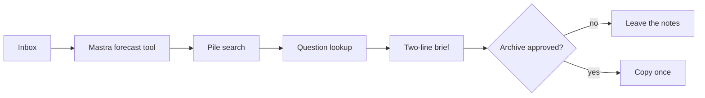

# Sloth Nap

An overnight chore agent for the [Hacktoberfest Week 3 challenge](https://dev.to/challenges/hacktoberfest-week3-2026-10-19). You drop the tasks you keep avoiding into `inbox/`. It ranks what you will skip, pulls the one date buried in the notes, looks up the question you did not want to search, and leaves two lines in `out/morning-brief.md`.

On the sample inbox that is the receipts and the landlord reply: about 55 minutes. Archiving the notes waits until you approve it.

## Run it

```bash
npm install
npm test
npm run nap
```

`npm start` serves the brief at `http://localhost:3000`. Add `--approve` to copy the notes into `out/archived`. Add `--slow` if you want a pause between steps.

The sample run does not call a hosted model. If [Ollama](https://ollama.com) is running with `gemma2:2b`, the two lines come from Gemma. Otherwise a template writes them from the same facts, and the brief says `model: template`.

```bash
ollama pull gemma2:2b
npm run nap
```

## How a nap moves



The forecast tool is a [Mastra](https://mastra.ai) tool on an agent with LibSQL memory. Skip risk is a small logistic model. `python/tabpfn_forecast.py` replaces it when TabPFN imports. `python/tinker_eval.py` checks a trained classifier against a majority-class baseline and calls Tinker only when `TINKER_API_KEY` is set and the `tinker` package imports.

Lease chunks are hidden unless the caller has `read:lease`. The archive writes an intent before it copies, and a second approval does not copy again.

`src/temporal/workflows.ts` is the durable version: same nap, then a signal wait for approval. The CLI runs those activities in process so you do not need a Temporal server for the demo. `docker compose --profile temporal up` starts one, and `npm run worker` connects to it.

## Keys

Copy `.env.example` to `.env`. Empty values stay on the local path. Set a variable and the matching call runs live.

| Variable | What it turns on |
| --- | --- |
| `OLLAMA_BASE_URL`, `GEMMA_MODEL` | Gemma writes the brief |
| `DATABASE_URL` | Tiger-compatible pgvector search |
| `MONGODB_URI` | Atlas nap memory |
| `SERPAPI_KEY` | Live search |
| `BROWSERBASE_API_KEY`, `BROWSERBASE_PROJECT_ID` | Stagehand opens the result |
| `ELEVENLABS_API_KEY` | mp3 of the two lines |
| `ULTRAMARINE_API_KEY`, `ULTRAMARINE_BASE_URL` | Paper Instruments summary |
| `BACKBOARD_API_KEY`, `BACKBOARD_BASE_URL` | Hosted assistant memory |
| `SENTRY_DSN` | Spans sent to Sentry. `out/trace.json` is always written |
| `AUTH0_DOMAIN`, `AUTH0_AUDIENCE` | Approval JWT via Auth0. Local tokens work without it |
| `TINKER_API_KEY` | LoRA client inside `python/tinker_eval.py` |
| `TECH_DOMAIN` | Printed by the web server once a `.tech` name points here |
| `ARDUINO_PORT` | UNO Q sketch in `arduino/sloth_nap` speaks the protocol in `src/arduino/protocol.ts` |

`render.yaml` and `deploy/digitalocean-app.yaml` are the host configs. `.github/workflows/overnight-nap.yml` runs the nap at 23:00 UTC.

## What ran here

`npm test` passes. `npm run nap` wrote the sample brief with the template, not Gemma. TabPFN and Tinker were not installed, so the logistic baseline ranked the chores and the local fine-tune beat a majority baseline by 0.05 on a 20-row holdout. No partner API was called.

## License

MIT.
